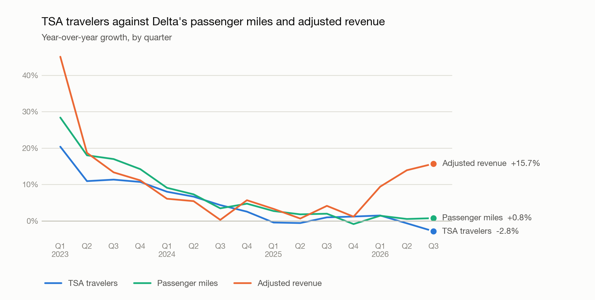

# TSA-Delta-Revenue-Backtest

Can an investor use daily TSA checkpoint counts to track Delta Air Lines' revenue before Delta reports it? This project back-tests that idea across 19 quarters, from Q1 2022 to Q3 2026, using only free public data.

The short write-up is in [memo.md](memo.md). The full analysis, with every step explained, is in [analysis.ipynb](analysis.ipynb).

## Key findings

- **TSA tracks how much people fly Delta very well.** TSA traveler growth and Delta's passenger mile growth have a correlation of 0.97.
- **It tracks revenue only when fares and trip lengths are steady.** The correlation with adjusted revenue growth is 0.89 through 2025, and 0.70 once 2026 is included.
- **2023: TSA understated revenue.** Long international trips came back, and the comparison was against a quarter depressed by the Omicron wave.
- **2024 and 2025: TSA worked.** Revenue growth stayed within about 4 points of TSA growth in every quarter.
- **2026: TSA missed a fare increase.** Delta's fuel price rose from $2.26 to $3.80 a gallon in a year, fares rose with it, and traffic stayed flat. Revenue grew up to 16% while TSA travelers fell.
- **A price signal helps.** A nowcast of Q3 2026 revenue from TSA data alone missed by 10.5%. Adding the airfare index cut the miss to 5.1%.



## Data sources

| File in `data/` | What it holds | Source | Script |
|---|---|---|---|
| `tsa_daily.csv` | Travelers screened per day | [TSA checkpoint travel numbers](https://www.tsa.gov/travel/passenger-volumes) | `download_tsa.py` |
| `delta_ops.csv` | Adjusted revenue, passenger miles, seat miles, yield, fuel price, and the date each was filed | Delta's quarterly earnings releases, filed with the SEC as 8-Ks | `download_delta_ops.py` |
| `delta_quarterly_revenue.csv` | GAAP revenue | [SEC EDGAR company facts](https://www.sec.gov/edgar/sec-api-documentation) | `download_delta_revenue.py` |
| `airfare_cpi_monthly.csv`, `airfare_cpi_quarterly.csv` | Consumer Price Index for airline fares | [Bureau of Labor Statistics](https://data.bls.gov/timeseries/CUUR0000SETG01), series CUUR0000SETG01 | `download_airfare_cpi.py` |

## Validation

Each script checks its own output and stops with an error if a day or quarter is missing. Delta's figures are compared across releases wherever a later release repeats them (108 of 133 figures so far), and the GAAP revenue in every release is matched against the SEC's data. Each year's four quarters were also confirmed to add up to Delta's printed annual totals for 2022 to 2025. I manually checked Q2 2023 and Q2 2026 against Delta's press releases, and all the figures matched.

## How to rerun

You need Python 3.10 or later.

1. Install the packages:

   ```bash
   pip install pandas requests lxml python-dotenv matplotlib nbconvert ipykernel
   ```

2. The SEC asks every API user to identify themselves. Copy the template and fill in your own name and email:

   ```bash
   cp .env.example .env
   ```

3. Download the data:

   ```bash
   python3 download_tsa.py
   python3 download_delta_revenue.py
   python3 download_delta_ops.py
   python3 download_airfare_cpi.py
   ```

4. Run the notebook from top to bottom. This also saves the charts to `figures/`:

   ```bash
   jupyter nbconvert --to notebook --execute --inplace analysis.ipynb
   ```

The notebook only reads the files in `data/`. It never downloads anything, so it can also be opened and run in VS Code or Jupyter as it is.

## Limitations

- TSA counts travelers on every airline, not just Delta, so the comparison depends on Delta's share of travelers staying roughly stable.
- Delta does not publish passenger counts, so its share and average trip length cannot be measured from these sources.
- The airfare index has no figure for October 2025, because of that year's government shutdown.
- 15 quarters of growth figures and one nowcast are a small sample.

## How this was built

I used Claude Code for the data pipeline and code, and made the analysis decisions myself.
