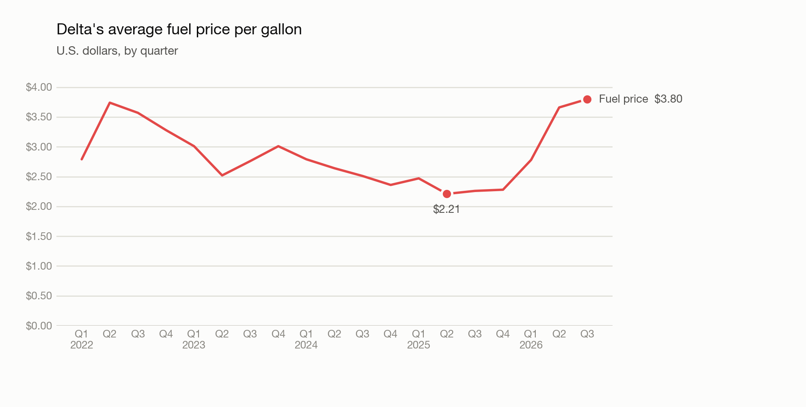
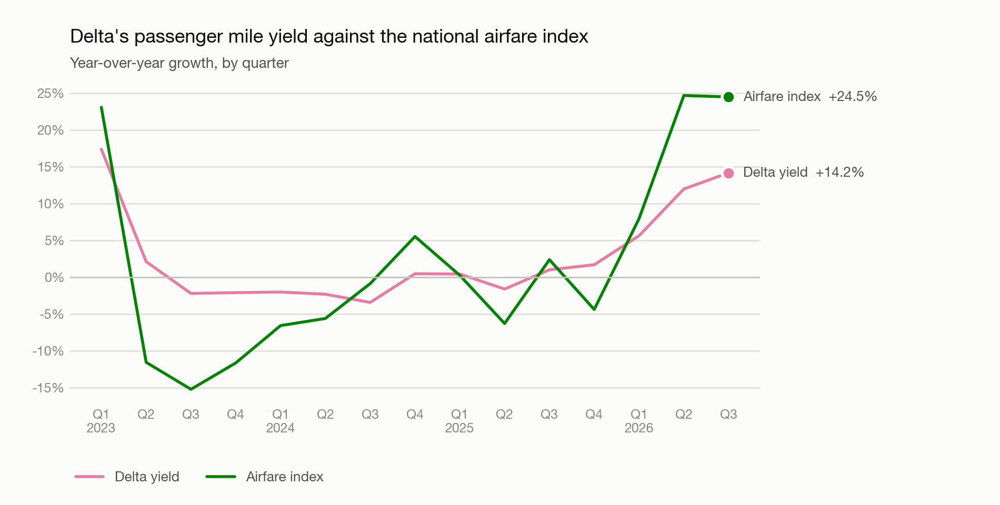

# Can an investor use TSA data to track Delta's revenue?

**Arjun Lakhanpal** | October 2026

## Short answer

Partly. TSA checkpoint counts are a very good read on how much people fly Delta. They are a good read on Delta's revenue only when fares and trip lengths are steady. That was true in 2024 and 2025. It was not true in early 2023 or in 2026, and in 2026 TSA data alone would have left an investor about 10% short of Delta's actual revenue.

## The question

The TSA publishes the number of travelers screened at U.S. airports every day, a few days after the fact. Delta reports revenue once a quarter. If the daily counts move with Delta's revenue, an investor could estimate the quarter before Delta announces it.

## Data

- **TSA daily traveler counts**, January 2022 to October 2026.
- **Delta's adjusted revenue, passenger miles, seat miles, yield and fuel price**, from its 19 quarterly earnings releases, Q1 2022 to Q3 2026.
- **Delta's GAAP revenue**, from the SEC, as a cross-check.
- **The Consumer Price Index for airline fares**, monthly, from the Bureau of Labor Statistics.

## Method

I summed the TSA counts into calendar quarters and compared year-over-year growth, which removes the seasons. Comparisons start in Q1 2023.

I used Delta's adjusted revenue, not GAAP revenue. GAAP revenue includes fuel that Delta's oil refinery sells to outside customers, which has nothing to do with flying. Those sales pulled GAAP growth 8.6 points below adjusted growth in early 2023 and pushed it 5.4 points above in 2026.

I recorded the date each Delta release was filed, so that the forecasting test could only use information that was public at the time.

## What I found

**TSA tracks Delta's volume closely.** TSA traveler growth and Delta's passenger mile growth have a correlation of 0.97. Against adjusted revenue the correlation is 0.89 through 2025, and 0.70 once 2026 is included.

**2023: TSA understated revenue.** TSA travelers grew 13% on average while adjusted revenue grew 22%. There were two causes. First, Q1 2022 was a weak base. Delta's own filings say demand only rebounded as the Omicron wave faded, and its planes were 75% full that quarter against 81% or more in later first quarters. Second, long international trips came back. In Q1 2023 Delta's domestic traffic grew 13% while its Atlantic traffic grew 93%. TSA counts a traveler once whether they fly to Orlando or to Rome.

**2024 and 2025: TSA worked.** Revenue growth stayed within about 4 points of TSA growth in every quarter.

**2026: TSA missed the fare increase.** Delta's traffic grew about 1% in each quarter, yet adjusted revenue grew 9%, 14% and 16%. The difference was price. Delta's fuel price rose from $2.26 a gallon in Q3 2025 to $3.80 in Q3 2026, and Delta's Q2 2026 10-Q says it raised prices in response to the rapid increase in fuel costs. Its yield, the average fare per mile, was up 14% by Q3.

## The nowcast test

I estimated Q3 2026 adjusted revenue using only data that was public before Delta reported on October 9.

| Method | Estimate | Actual | Miss |
|---|---|---|---|
| A: TSA growth plus the average recent gap | $15.74B | $17.59B | 10.5% low |
| B: TSA growth plus scaled airfare growth | $16.69B | $17.59B | 5.1% low |

Method A had no way to see prices, so it missed badly. Method B added the airfare index, scaled down because the index swings about twice as hard as Delta's own prices. That cut the miss in half. Most of what remained was not about price: TSA travelers fell 2.8% in the quarter while Delta's own traffic rose 0.8%.

## Limitations

- **TSA counts every airline.** The comparison only works if Delta's share of travelers stays roughly stable, and Delta does not publish passenger counts.
- **Trip mix.** A shift toward longer or international trips raises revenue without raising the TSA count.
- **A gap in the airfare data.** The BLS published no figure for October 2025 because of the government shutdown, so that quarter rests on fewer months.
- **Small sample.** There are 15 quarters of growth figures and one nowcast. That is enough to show the pattern, not enough to trust a model.

## Recommendation and next step

TSA data is worth using as a volume signal, but not on its own. It should be paired with a price signal, and an investor should expect it to fail whenever fares or trip mix shift quickly.

The next step is to add the Department of Transportation's passenger data by airline. That would show Delta's own passenger count, which gives both its market share and its average trip length, the two things this analysis could not measure directly.
